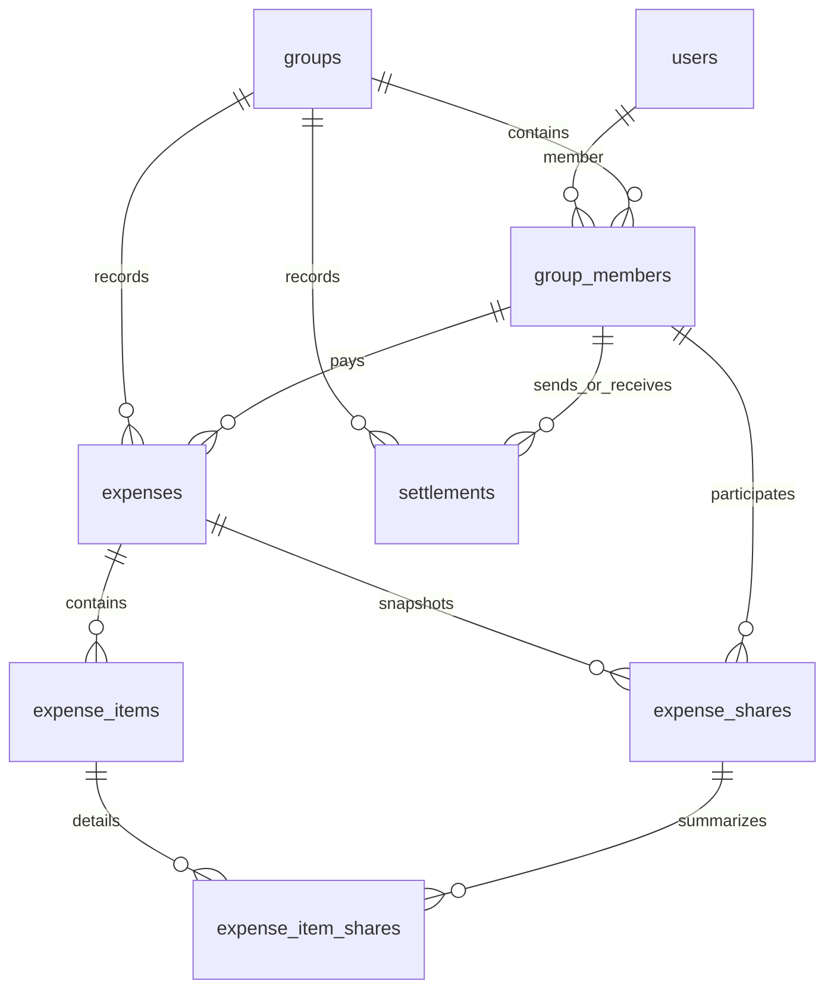

# O-03 — финансовые таблицы и границы гарантий

**Статус: предложение для Draft PR, Refs #23.** Наличие ORM и миграции
не утверждает продуктовый или HTTP-контракт. До Ready/merge нужны решения
Тимура и Леры по Q-03/Q-10 и подтверждение полей `position`/`resolved_at`.

Основание: [Issue #23](https://github.com/inte11ectua1/skinulis/issues/23),
[согласованный identity T-06](https://github.com/inte11ectua1/skinulis/issues/22#issuecomment-6437632203),
[финансовый checkpoint для согласования](https://github.com/inte11ectua1/skinulis/issues/23#issuecomment-6466134697).
На старте main `fe3574a` включает PR #17/#19/#26/#27/#28/#30;
проверенный head — `0003_groups_identity`.

## Таблицы

Все ID и `amount_kopecks` — signed BIGINT. У surrogate ID — Identity и CHECK >0.
UUID — PostgreSQL UUID. Обязательные поля NOT NULL; nullable только
`expenses.deleted_at` и `settlements.resolved_at`. Все временные поля TIMESTAMPTZ,
`created_at DEFAULT now()`. Новых колонок в users/groups и кеша балансов нет.

| Таблица | Поля | Назначение |
|---|---|---|
| expenses | id, group_id, payer_id, title VARCHAR(120), split_mode VARCHAR(8), amount_kopecks, client_request_id, created_at, deleted_at | Расход 1..100000000 коп.; payer — автор/плательщик; equal/custom/by_items |
| expense_items | id, expense_id, group_id, title VARCHAR(120), amount_kopecks, position SMALLINT | Положительная стоимость позиции и стабильный порядок 1..50 |
| expense_shares | expense_id, user_id, group_id, amount_kopecks | Сохранённые итоговые доли ≥0; будущий источник баланса |
| expense_item_shares | item_id, user_id, expense_id, group_id, amount_kopecks | Детализация позиций ≥0; повторно в баланс не вычитается |
| settlements | id, group_id, sender_id, receiver_id, amount_kopecks, status VARCHAR(9), client_request_id, created_at, resolved_at | Перевод >0 между разными участниками; pending по умолчанию, confirmed/rejected/cancelled |

`position` предлагается как обязательный исторический порядок. В сочетании
с UNIQUE и CHECK он физически ограничивает число позиций 50; плотная нумерация
не гарантируется. `resolved_at` предлагается как время terminal-перехода:
pending требует NULL, каждый terminal — время не раньше created_at.
Это структура строки, а не state machine или журнал всех переходов.



## Именованные ограничения

PK: `pk_expenses(id)`, `pk_expense_items(id)`,
`pk_expense_shares(expense_id,user_id)`,
`pk_expense_item_shares(item_id,user_id)`, `pk_settlements(id)`.

| FK (везде ON DELETE RESTRICT) | Локальные колонки → цель |
|---|---|
| fk_expenses_group | group_id → groups.id |
| fk_expenses_payer_membership | (group_id,payer_id) → group_members(group_id,user_id) |
| fk_expense_items_expense | (expense_id,group_id) → expenses(id,group_id) |
| fk_expense_shares_expense | (expense_id,group_id) → expenses(id,group_id) |
| fk_expense_shares_membership | (group_id,user_id) → group_members(group_id,user_id) |
| fk_expense_item_shares_item | (item_id,expense_id,group_id) → expense_items(id,expense_id,group_id) |
| fk_expense_item_shares_final_share | (expense_id,user_id) → expense_shares(expense_id,user_id) |
| fk_settlements_group | group_id → groups.id |
| fk_settlements_sender_membership | (group_id,sender_id) → group_members(group_id,user_id) |
| fk_settlements_receiver_membership | (group_id,receiver_id) → group_members(group_id,user_id) |

Membership уже имеет FK на users/groups, поэтому финансовый FK одновременно
проверяет существование пользователя и его членство именно в нужной группе.
Для item share членство следует транзитивно из final share: обе строки обязаны
иметь один expense, а цепочка item → expense фиксирует group. Даже пользователь,
состоящий в обеих группах, не позволяет смешать их позиции/снимки.
FK не заменяет проверку actor и прав на запись.

UNIQUE:

- `uq_expenses_request(group_id,client_request_id)`;
- `uq_settlements_request(group_id,client_request_id)`;
- `uq_expenses_id_group(id,group_id)`;
- `uq_expense_items_parent(id,expense_id,group_id)`;
- `uq_expense_items_position(expense_id,position)`.

Первые два запрещают повтор финансовой записи внутри группы и типа операции,
в том числе после soft-delete. Один UUID допустим между группами и между
expenses/settlements. Сравнение тела, actor и исходного ответа для replay —
Q-06/O-04/O-07. Дополнительные UNIQUE с `id` нужны как точные targets составных
FK в PostgreSQL; простого surrogate PK для этих ссылок недостаточно.

| CHECK | Условие |
|---|---|
| ck_expenses_id_positive, ck_expense_items_id_positive, ck_settlements_id_positive | id >0 |
| ck_expenses_title, ck_expense_items_title | char_length(title) BETWEEN 1 AND 120 |
| ck_expenses_split_mode | equal/custom/by_items |
| ck_expenses_amount | 1..100000000 |
| ck_expense_items_amount, ck_settlements_amount | >0 |
| ck_expense_shares_amount, ck_expense_item_shares_amount | ≥0 |
| ck_expense_items_position | 1..50 |
| ck_expenses_deleted_at | NULL или deleted_at ≥ created_at |
| ck_settlements_parties | sender_id <> receiver_id |
| ck_settlements_status | pending/confirmed/rejected/cancelled |
| ck_settlements_resolved_at | pending с NULL; terminal с NOT NULL и resolved_at ≥ created_at |

Если строка нарушает несколько ограничений, порядок первого сообщения об ошибке
не является контрактом. Временные значения хранят момент времени: PostgreSQL
возвращает его в timezone соединения. Тип TIMESTAMPTZ не доказывает наличие
offset в исходном вводе; наивный timestamp СУБД интерпретирует в timezone сессии.
HTTP-сериализация UTC из PR #30 здесь не меняется.

## Индексы

| Индекс | Путь чтения/удаления будущего сервиса |
|---|---|
| ix_expenses_group_created(group_id,created_at,id) | История расходов группы с устойчивой пагинацией |
| ix_expense_shares_member(group_id,user_id,expense_id) | Снимки долей участника группы |
| ix_expense_item_shares_final(expense_id,user_id) | Детали снимка/атомарная замена долей |
| ix_settlements_group_created(group_id,created_at,id) | История компенсаций группы |
| ix_settlements_receiver_status(receiver_id,status,created_at,id) | Входящие pending/история получателя |

PK/UNIQUE уже дают индексы. Отдельный индекс по expense_items.expense_id
не нужен: UNIQUE(expense_id,position) имеет этот левый префикс. Планы запросов
и дополнительные индексы следует проверять на реальных запросах O-04–O-07.

## История, транзакции и границы

Soft-delete меняет только deleted_at. Все items/final shares/item shares остаются;
новый участник не получает строк старых расходов. UUID остаётся занятым.
Settlements относятся к группе, а не к конкретному расходу: изменение/soft-delete
расхода не обновляет подтверждённый перевод. RESTRICT запрещает удалить связанные
expense/item/final share/member/user/group, пока существуют дочерние записи.
Нет ORM delete cascade или SQL ON DELETE CASCADE. Привилегированный прямой DELETE
самой компенсации или последовательное удаление детей не запрещены: это не
неизменяемый ledger. Запрет корректировать confirmed обязан реализовать O-07.

Будущая финансовая запись должна сначала брать `groups FOR UPDATE`, затем
читать/изменять финансовые строки и commit единым действием. Identity locks
не вкладываются в эту транзакцию. В O-03 проверен rollback при ошибке в середине
записи; сервис и финансовые гонки пока не реализованы.

Обычные CHECK/FK **не гарантируют**: сумму долей = расходу/позиции,
сумму позиций = расходу, итоговую долю = сумме деталей пользователя,
наличие хотя бы одной доли/позиции, полноту union потребителей, принадлежность
items только режиму by_items, корректность equal-остатка, права, отсутствие
переплаты, текущий баланс, разрешённый переход статуса и идемпотентный confirm.
Это проверки O-04/O-05/O-06/O-07 в групповой транзакции. Тест намеренно показывает,
что несогласованные межстрочные суммы физически записываются: таких гарантий нет.

## Открытые решения

- **Q-03, предложено, не утверждено:** raw Unicode, длина 1..120 code points,
  без NFC/trim. DB сохраняет пробелы и комбинируемые символы буквально; один emoji
  может состоять из нескольких code points. Отказ от whitespace-only на будущей
  входной границе нужно согласовать отдельно. CHECK не имитирует Python isspace.
  PostgreSQL text также физически не хранит U+0000. T-06 нормализация имён групп
  на финансовые названия не переносится. Предохранитель O-02 не меняется.
- **Q-10, предложено, не утверждено:** хранить все явно выбранные нулевые доли
  и в final, и в деталях; отсутствие строки = не участвовал. Final snapshot —
  union потребителей позиций, даже если их сумма 0. БД разрешает ноль и запрещает
  дубликаты; полноту выбранного набора обеспечит сервис.
- **Q-04:** принятый предел одного расхода 100000000 не распространяется
  на компенсацию и баланс. Физический максимум положительного BIGINT —
  9223372036854775807 коп.; это граница хранения одной строки, не новый лимит долга.
  `SUM(bigint)` в PostgreSQL возвращает точный NUMERIC. Тест суммирует два
  максимальных BIGINT и проверяет результат выше диапазона BIGINT без потери.
  Будущий сервис должен вычитать NUMERIC-агрегаты, преобразовывать целый результат
  в Python int без float и без cast суммы обратно в BIGINT. Нельзя сначала
  складывать отдельные BIGINT выражения, которые могут переполниться до SUM;
  использовать отдельные агрегаты или NUMERIC до арифметики. Публичный ввод,
  отображение больших долгов и политика перевода при превышении одной строки
  остаются на согласовании до O-04/O-07; автоматического ограничения 100000000 нет.
- `position` 1..50 и `resolved_at` с указанным CHECK — предложения этого Draft;
  до merge требуется подтверждение структуры. Финансовые API здесь не появляются.

## Миграция и проверка

`0004_financial_domain → 0003_groups_identity → 0002_users → 0001_baseline`:
один линейный head. Новая ревизия создаёт только пять финансовых таблиц,
их ограничения и индексы. Старые migrations/users/groups не меняются.
Downgrade удаляет только эти пять таблиц в обратном порядке зависимостей;
для реальных финансовых данных это потеря данных и не штатный способ отката.
В тесте downgrade выполняется только на собственной disposable БД.
Нет create_all, startup migration или доступа к пользовательской БД.

`tests/integration/test_financial_models.py` использует общий `database_url`:
PostgreSQL 17, отдельная случайная БД на тест, очистка только своей БД.
Проверены clean/repeat upgrade и metadata drift общим migration-тестом;
новый тест отдельно сохраняет существующие users/groups/members при upgrade,
проверяет downgrade/re-upgrade, constraints, scopes UUID, нулевые снимки,
мягкое удаление, RESTRICT, rollback, BIGINT/NUMERIC и timezone соединения.
Два прежних теста обновляют только ожидаемый head/перечень таблиц.

Команды из корня репозитория:

```powershell
uv run alembic heads
uv run alembic history
uv run pytest --cov=app --cov=bot --cov-report=term-missing
uv run python scripts/test_integration.py --cov=app --cov=bot --cov-append --cov-report=term-missing
uv run coverage report --include="app/models/finance.py"
```

`alembic check` вызывается тестами внутри disposable database_url.
Покрытие строк ORM показывает загрузку деклараций; корректность SQL-ограничений
доказывают реальные отрицательные PostgreSQL-тесты, не процент покрытия класса.
Эти тесты не являются тестами будущих HTTP CRUD, баланса или state machine.

Локальная проверка 28.10.2026: 587 unit и 138 integration passed, из них
62 новых финансовых сценария. Покрытие с ветвями после обоих наборов: app+bot
96,63%, finance.py 100%, test_financial_models.py 99,04%. Последнее измерено
отдельно включением tests/integration во временный coverage config без omit;
штатный config исключает тесты из покрытия продукта. Непокрыты только защитные
ветки helper для неизвестного имени таблицы (строки 110–111); их не вызываем
искусственно ради процента. Все constraints проверяются PostgreSQL, не coverage.

Прошли sync --frozen, lock --check, Ruff check/format, mypy .,
pre-commit --all-files, uv pip check, uv audit --locked и git diff --check.
Единственное предупреждение тестов — существующая Starlette/httpx deprecation;
зависимости в O-03 не менялись. GitHub Actions проверяется отдельно в PR:
локальные результаты не означают успешного remote run или approval контракта.
